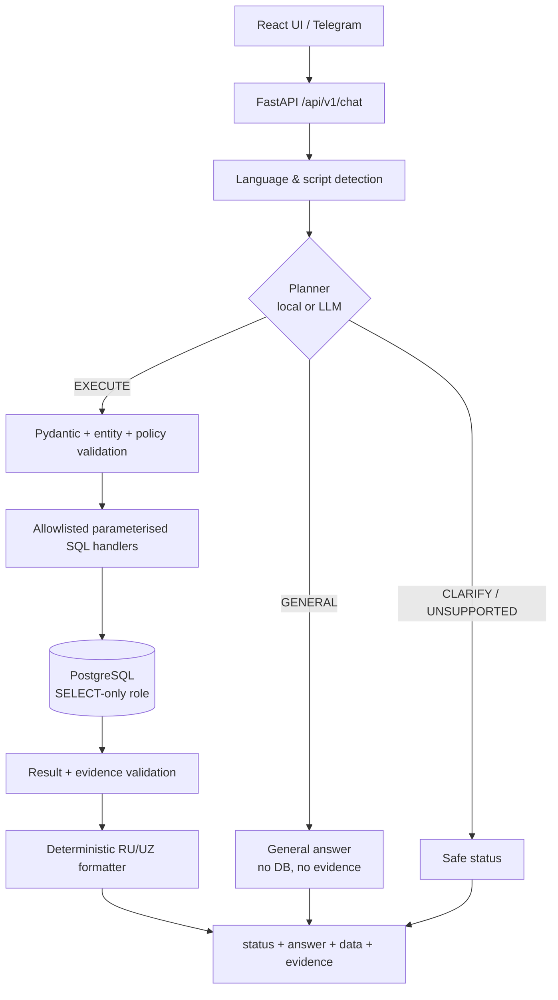

<div align="center">

# UZEX Data Agent

**Аналитический AI-агент по сделкам UZEX.  
Отвечает только по данным PostgreSQL — с evidence и безопасным отказом вместо выдумок.**

[](#-хакатон-uzex)
[](https://www.python.org/)
[](https://fastapi.tiangolo.com/)
[](https://www.postgresql.org/)
[](https://react.dev/)
[](https://docs.docker.com/compose/)
[](https://core.telegram.org/bots)
[](#-тесты-и-качество)

</div>

---

## 🏆 Хакатон UZEX

Проект создан для **хакатона UZEX** как решение задачи аналитики по биржевым сделкам:
пользователь задаёт вопрос обычным языком, а агент возвращает проверенный ответ с числами,
источником и evidence — либо честно отказывается, если подтвердить ответ нельзя.

**Проблема.** LLM легко отвечает правдоподобно, но не гарантирует точность. Для биржевой
аналитики одна выдуманная цифра хуже, чем отсутствие ответа.

**Решение.** LLM не получает доступ к базе и не пишет SQL. Он формирует строгий JSON-план,
который проходит валидацию и исполняется только через allowlisted параметризованные SQL-handlers
от имени `SELECT`-only роли PostgreSQL. Каждый ответ `FOUND` содержит evidence, а любой сбой
или неоднозначность возвращают безопасный статус.

**Результат.** 500 000 сделок, 3 языка (RU / UZ Latin / UZ Cyrillic), веб-интерфейс и
Telegram-бот, 719 прошедших тестов, 100/100 стандартных и 180/180 диалоговых проверок.

---

## ✨ Почему это интересно

| Grounded by design | Безопасность | Production-опыт |
|---|---|---|
| LLM только планирует запрос. SQL собирается из allowlist-handlers, а не генерируется моделью. | Runtime-доступ к БД — только `SELECT`. Секреты живут на сервере, не во frontend. | Docker Compose, nginx, healthchecks, Alembic, импорт с integrity checks и атомарным переключением датасета. |
| Каждый `FOUND` несёт `data` + `evidence`; число можно проверить. | Ambiguous → `NEEDS_CLARIFICATION`, unsupported → `UNSUPPORTED`, сбой → `UNVERIFIED`. | Проверено на AWS EC2 с реальным Telegram long polling. |

---

## 📌 Статус

- ✅ Реализовано и проверено end-to-end.
- ✅ Telegram-бот запускался в Docker Compose на AWS EC2; импорт — 500 000 сделок.
- ⏸️ Демонстрационный инстанс выключен, публичного URL сейчас нет.
- 🔐 В репозитории нет ключей и реальных `.env`. Для запуска нужен свой `GROQ_API_KEY`
  или полностью офлайн-режим `PLANNER_MODE=local`.

Отчёт о проверенном деплое: [`docs/v3_deployment_report.md`](docs/v3_deployment_report.md)
(идентификаторы инфраструктуры отредактированы для публичной копии).

> **Данные синтетические.** Набор `uzex_spot_data.zip` вымышленный — это прямо указано в
> исходном README. Архив не входит в репозиторий; положите его в корень проекта перед импортом.

---

## 🚀 Что умеет

- **Сделки:** количество всего и по периодам, статусам, типу контракта, товару, региону, участнику.
- **Деньги:** суммы, средние, min/max в UZS и USD — без смешивания валют без метода конвертации.
- **Объёмы:** физические объёмы и поставки с группировкой по единицам измерения.
- **Рейтинги:** топ-N продавцов, покупателей и брокеров.
- **Динамика:** сравнение периодов и тренды по годам.
- **Точный поиск:** сделка, контракт, участник, брокер.
- **Списки:** последние и отфильтрованные сделки.
- **General AI Mode:** свободный диалог и объяснение терминов — без доступа к БД и без выдачи
  общих знаний за проверенные факты.

Языки ответа: **русский**, **узбекский латиница**, **узбекский кириллица**.

### Статусы ответа

| Статус | Что означает |
|---|---|
| `FOUND` | Данные найдены; ответ содержит `data` и `evidence`. |
| `NOT_FOUND` | Запрос выполнен, совпадений в активном наборе нет. |
| `NEEDS_CLARIFICATION` | Сущность или условие неоднозначны; агент не угадывает. |
| `UNSUPPORTED` | Вопрос нельзя достоверно выполнить на текущей схеме. |
| `UNVERIFIED` | Ошибка или непровалидированный результат; это **не** `NOT_FOUND`. |
| `GENERAL` | Ответ из общих знаний; без `data`/`evidence`, не факт реестра. |
| `GENERAL_UNAVAILABLE` | General-ответ временно недоступен (например, квота провайдера). |

### General AI Mode

Планировщик сам выбирает режим:

| Вопрос | Режим |
|---|---|
| «Что такое экспорт?» | `GENERAL` — объяснение без БД |
| «Сколько экспортных сделок было в 2024 году?» | `EXECUTE` — строгий SQL-план |
| «Почему экспортных сделок стало меньше?» | `EXECUTE` + блок гипотез после фактов |

Гарантии: `GENERAL` никогда не содержит `data`/`evidence`, не открывает соединение с БД и не
выдаётся за проверенный факт. Если LLM ошибочно относит реестровый вопрос к `GENERAL`,
срабатывает защита и вопрос уходит в детерминированный план данных.

---

## 🧭 Архитектура



```text
question
  -> language/script detection
  -> strict JSON QueryPlan (EXECUTE | CLARIFY | UNSUPPORTED | GENERAL)
  -> Pydantic validation
  -> entity resolution (exact match; ambiguity -> clarification)
  -> allowlist/policy validation
  -> parameterised SQL handler (13 handlers)
  -> PostgreSQL read-only
  -> result + evidence validation
  -> deterministic formatter
  -> response
```

**Ключевые инженерные решения**

- LLM **не** получает SQL-доступ, файлы, shell, Python, интернет или произвольные tools.
- SQL, «сгенерированный» моделью, никогда не исполняется.
- Пользовательский текст не конкатенируется в SQL.
- Денежные значения — `Decimal` / PostgreSQL `NUMERIC`, не `float`.
- `NULL` не превращается в `0`; UZS и USD не смешиваются; физические единицы не складываются.
- Товары связываются через `contract_no`, а не по названию.
- `warehouse_region` не трактуется как регион компании.
- Ошибка LLM/БД даёт `UNVERIFIED` или `GENERAL_UNAVAILABLE`, а не ложный `NOT_FOUND`.

---

## 🛠 Технологии

| Слой | Стек |
|---|---|
| Backend | Python 3.12, FastAPI, Pydantic v2, SQLAlchemy 2, Alembic, psycopg2 |
| База данных | PostgreSQL 18 (совместимо с 14+), read-only runtime role |
| Frontend | React 18, Vite 5 |
| LLM | Groq `openai/gpt-oss-120b` (опционально), детерминированный local planner |
| Бот | Telegram Bot API, long polling |
| Инфраструктура | Docker Compose, nginx, healthchecks, AWS EC2, SSM Parameter Store |
| Качество | pytest, 100-вопросный evaluation set, adversarial и reliability тесты |

---

## ⚡ Быстрый старт

### Вариант 1 — Docker Compose

```bash
git clone https://github.com/cyberbazauz/uzex-data-agent.git
cd uzex-data-agent
cp .env.example .env
# заполните POSTGRES_PASSWORD, UZEX_READER_PASSWORD, APP_SECRET
# положите uzex_spot_data.zip в корень проекта

# веб-стек без Telegram:
docker compose up --build db migrate import api web
```

UI: `http://localhost:8080`  
API: `http://localhost:8000/api/v1/health`

Сервисы: `db → migrate → import → api → web`. Импорт идемпотентен: staging → integrity checks →
атомарное переключение версии датасета.

**Telegram-бот (опционально).** Добавьте `TELEGRAM_BOT_TOKEN` в `.env` и запустите:

```bash
docker compose up -d --build telegram-bot
```

### Вариант 2 — локально

```powershell
Copy-Item backend\.env.example backend\.env
# DATABASE_URL, DATABASE_READONLY_URL, PLANNER_MODE=local
```

```powershell
$env:PYTHONPATH="$PWD\backend"
$env:PYTHONIOENCODING="utf-8"
Set-Location backend
python -m alembic upgrade head
python -m importer.import_cli
python -m uvicorn app.main:app --host 127.0.0.1 --port 8000
```

Frontend:

```powershell
Set-Location frontend
npm install
npm run dev
```

Dev UI: `http://127.0.0.1:5173`. Vite проксирует `/api` на `http://127.0.0.1:8000`
(переопределяется через `VITE_PROXY_TARGET`).

Подробная настройка PostgreSQL, импорта и production-сборки — в разделах ниже и в
[`docs/test_report.md`](docs/test_report.md).

<details>
<summary><b>PostgreSQL: роли и запуск локального кластера</b></summary>

```sql
CREATE ROLE uzex_owner LOGIN PASSWORD '...';
CREATE ROLE uzex_reader LOGIN PASSWORD '...';
CREATE DATABASE uzex OWNER uzex_owner;
\c uzex
GRANT USAGE ON SCHEMA public TO uzex_reader;
ALTER DEFAULT PRIVILEGES FOR ROLE uzex_owner IN SCHEMA public
  GRANT SELECT ON TABLES TO uzex_reader;
ALTER ROLE uzex_reader SET default_transaction_read_only = on;
```

```powershell
& "D:\Program Files\PostgreSQL\18\bin\pg_ctl.exe" `
  -D "$PWD\data\pgdata" `
  -o "-p 55432 -c listen_addresses=127.0.0.1" `
  -l "$PWD\data\pg.log" start
```

Если PostgreSQL установлен в другом месте, замените путь к `pg_ctl.exe`.

</details>

---

## 🔌 API

Префикс: `/api/v1`.

| Метод | Endpoint | Назначение |
|---|---|---|
| `GET` | `/health` | liveness |
| `GET` | `/ready` | готовность БД, датасета и схемы |
| `GET` | `/meta` | публичные счётчики и версия датасета |
| `GET` | `/examples` | примеры вопросов |
| `POST` | `/chat` | ответ на вопрос |

```bash
curl -X POST http://127.0.0.1:8000/api/v1/chat \
  -H "Content-Type: application/json" \
  -d '{"question":"Сколько сделок было в 2024 году?"}'
```

Ответ `FOUND` содержит `answer`, `data`, `evidence`, `request_id`, `duration_ms`.
Поддерживается заголовок `X-Request-ID`; он попадает в structured logs.

---

## 🔐 Безопасность

- LLM получает только текст вопроса и декларативные подсказки.
- Ответ модели валидируется по строгой JSON-схеме; всё остальное отклоняется.
- SQL строится только из allowlisted handlers; значения передаются параметрами.
- Runtime-роль PostgreSQL — только `SELECT`.
- Секреты — только environment / server-side `.env`, никогда в `VITE_*` или frontend.
- Логи структурированные, с `request_id`, без секретов.
- Политика раскрытия уязвимостей: [`SECURITY.md`](SECURITY.md).

---

## ✅ Тесты и качество

```powershell
$env:PYTHONPATH="$PWD\backend"
$env:PYTHONIOENCODING="utf-8"
python -m pytest -q
```

| Проверка | Результат |
|---|---|
| Полный pytest (V3) | **719 passed, 1 skipped** |
| Стандартный evaluation set | **100/100** |
| Диалоговые проверки | **180/180** |
| Импорт | 500 000 сделок, integrity checks пройдены |

Пропущенный тест — живой 100-вопросный прогон; включить:

```powershell
$env:UZEX_RUN_EVALUATION="1"
python -m pytest -q backend/tests/test_evaluation.py
```

---

## 📁 Структура проекта

| Путь | Назначение |
|---|---|
| `backend/app/agent/` | planner, QueryPlan, orchestrator, General AI Mode |
| `backend/app/handlers/` | allowlisted SQL handlers и dispatch |
| `backend/app/entities/` | точное разрешение сущностей |
| `backend/app/validation/` | валидация плана, результата и evidence |
| `backend/app/responses/` | детерминированный RU/UZ formatter |
| `backend/app/language/` | словари и шаблоны RU / UZ Latin / UZ Cyrillic |
| `backend/app/telegram/` | long-polling worker, сессии, rate limit |
| `backend/importer/` | staging, integrity checks, атомарный импорт |
| `backend/alembic/` | миграции схемы |
| `frontend/` | React + Vite UI |
| `deploy/` | nginx, AWS/SSM-скрипты, init read-only роли |
| `docs/` | data dictionary, отчёты тестов и деплоя |
| `data/manifests/` | checksums и отчёты импорта |

---

## 📚 Документация

- [`UZEX_AI_AGENT_ARCHITECTURE.md`](UZEX_AI_AGENT_ARCHITECTURE.md) — техническая спецификация.
- [`docs/data_dictionary.md`](docs/data_dictionary.md) — структура данных и бизнес-правила.
- [`docs/test_report.md`](docs/test_report.md) — тесты, импорт, evaluation, ограничения.
- [`docs/v3_deployment_report.md`](docs/v3_deployment_report.md) — проверенный AWS/Telegram-деплой.
- [`docs/architecture_report.md`](docs/architecture_report.md) — архитектурный разбор.
- [`AGENTS.md`](AGENTS.md) — инженерные правила проекта.

---

## ⚠️ Ограничения

- Evaluation 100/100 — совпадение с заранее заданными ожиданиями, а не доказательство корректности
  любых формулировок.
- Бесплатный Groq tier ограничен ~200 000 токенов в сутки на организацию (около 40–50
  реестровых вопросов). При исчерпании квоты агент возвращает `UNVERIFIED` /
  `GENERAL_UNAVAILABLE`, а не выдуманный ответ.
- Демо-инстанс выключен; публичного URL сейчас нет.
- Локальный planner намеренно fail-closed: незнакомые формулировки дают `UNSUPPORTED`,
  неоднозначные — `NEEDS_CLARIFICATION`.
- Данные синтетические; проект не утверждает, что набор описывает реальную биржу.

---

## 👤 Автор

**cyberbazauz** — [github.com/cyberbazauz](https://github.com/cyberbazauz)

Проект создан для хакатона UZEX. Вопросы и предложения — через GitHub Issues.

---

<details>
<summary><b>🇬🇧 English summary</b></summary>

A grounded data agent over a synthetic UZEX deal registry, built for the UZEX hackathon.
The LLM only produces a strict JSON `QueryPlan`; every number comes from a parameterised,
allowlisted SQL handler executed through a `SELECT`-only PostgreSQL role, and every `FOUND`
answer carries evidence. Unsupported or ambiguous questions fail closed
(`UNSUPPORTED` / `NEEDS_CLARIFICATION`), and infrastructure errors return `UNVERIFIED`
instead of a fake `NOT_FOUND`.

**Stack:** FastAPI, SQLAlchemy, Alembic, PostgreSQL, React/Vite, Docker Compose, Telegram long
polling, optional Groq planner. Includes 719 passing tests, a 100-question evaluation set, and a
verified AWS EC2 deployment. The demo host has been decommissioned; no credentials or live
infrastructure identifiers are included in this repository.

</details>
